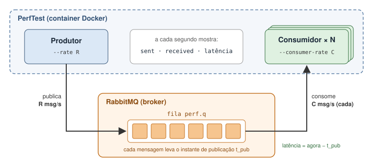

## Lab 5: Broker e topologias com utilização de UI web

**Objetivos:** pôr o RabbitMQ a correr localmente e numa VM GCP; montar e testar topologias pub/sub na UI de gestão; observar encaminhamento e carga.

**Pré-requisitos:** projeto GCP e VM com Docker (Lab 01).

### P1 — RabbitMQ local

```bash
docker run -d --name rabbitmq --hostname rabbithost -p 5672:5672 -p 15672:15672 rabbitmq:4-management
```

1. Abrir `http://localhost:15672` (guest/guest) e percorrer Overview, Connections, Exchanges e Queues.
Criar um primeiro exchange e uma fila:
   - em *Exchanges → Add a new exchange*, criar `greetings` do tipo **direct**;
   - em *Queues → Add a new queue*, criar a fila `hello.q`;
   - na página do exchange `hello`, em *Bindings*, ligar a fila `hello.q` com a routing key `hello`.
3. Na página do exchange `greetings`, em *Publish message*, publicar:
   - uma mensagem com a routing key `hello`;
   - outra com a routing key `bye`.

   **Pergunta:** quantas mensagens tem `hello.q`? O que aconteceu à segunda?
4. Em *Queues → hello.q → Get messages*, experimente ler a mensagem com *Nack message requeue true* e com *Automatic Ack*.


### P2 — RabbitMQ na VM GCP

1. Acrescente uma regra à firewall para que seja possível estabelecer ligações com os portos 5672 e 15672.
   
2. Na VM, lançar o broker com credenciais próprias, volume e reinício automático:
   ```bash
   docker run -d --name rabbitmq --hostname rabbithost \
     -p 5672:5672 -p 15672:15672 \
     -e RABBITMQ_DEFAULT_USER=cdisel -e RABBITMQ_DEFAULT_PASS='<password-forte>' \
     rabbitmq:management
   ```
3. Abrir `http://<IP-VM>:15672` com o utilizador `cdisel`.
4. **Pergunta:** que risco existe em abrir a 15672 a `0.0.0.0/0` com guest/guest?

### P3 — Montar topologias na UI (30 min)

**O exchange 'notas' (fanout) dos slides**

1. Criar:
   - o exchange `notas` (fanout, durable);
   - as filas `pautas` e `notificacoes` (durable), ambas ligadas a `notas`.
2. Publicar 2 mensagens em `notas` com o corpo `{"numAluno":"A51234","uc":"CD","nota":14}`. Confirmar que cada fila tem 2 mensagens.
3. Criar agora a fila `estatisticas`, ligá-la a `notas` e publicar mais 1 nota. **Pergunta:** quantas mensagens tem `estatisticas`? Porque não tem 3?
4. Retirar as mensagens de `pautas` com *Get messages*. **Pergunta:** isso afetou `notificacoes`?

<!-- 
**b) Encaminhamento (topic)**
1. Criar o exchange `notas.topic` (topic) e as filas `q-meic` (binding `MEIC.*`) e `q-cd` (binding `*.CD`).
2. **Prever antes de publicar.** Preencher a tabela com ✓ ou ✗ e depois confirmar publicando cada chave:

   | Routing key | q-meic | q-cd |
   | ----------- | ------ | ---- |
   | `MEIC.CD`   |        |      |
   | `LEIC.CD`   |        |      |
   | `MEIC.SD`   |        |      |
   | `LEIC.PG`   |        |      |
   | `MEIC`      |        |      |
3. **Pergunta:** que binding usariam para uma fila que recebesse tudo? -->


### P4 — Edge e cloud: ligar dois brokers com um shovel (25 min)

**Cenário:** o broker do portátil (P1) faz de **edge**, por exemplo um servidor no campus que recebe as notas mesmo quando a ligação à Internet falha. O broker da VM faz de **cloud**, onde correm Pautas e Notificações. Um **shovel** no edge reencaminha para a cloud tudo o que chega à fila local `to-cloud`.

```
 portátil (edge)                                          VM GCP (cloud)
 notas (fanout) ──► to-cloud ══ shovel (AMQP, 5672) ══► notas (fanout) ──► pautas
                                                                         └─► notificacoes
```

1. **Ativar o plugin no edge** (incluído no RabbitMQ mas é preciso ativar):
   ```bash
   docker exec rabbitmq rabbitmq-plugins enable rabbitmq_shovel rabbitmq_shovel_management
   ```
2. **Topologia no edge** (UI em `http://localhost:15672`): criar o exchange `notas` (fanout) e a fila `para-cloud` ligada a ele.
3. **Criar o shovel no edge.** Pode fazer-se pela UI, em *Admin → Shovel Management → Add a new shovel*, ou por linha de comando:
   ```bash
   docker exec rabbitmq rabbitmqctl set_parameter shovel edge-to-cloud \
     '{"src-protocol": "amqp091", "src-uri": "amqp://", "src-queue": "to-cloud",
       "dest-protocol": "amqp091", "dest-uri": "amqp://cdisel:<password-forte>@<IP-VM>:5672",
       "dest-exchange": "notas", "ack-mode": "on-confirm"}'
   ```
   - `src-uri: amqp://` significa "este broker".
   - O exchange `notas` tem de existir na cloud (P3a).
4. **Verificar:** em *Admin → Shovel Status* o estado deve ser `running`. Na UI da cloud, em *Connections*, aparece uma ligação vinda do vosso IP.
5. **Funcionamento normal:** publicar 2 notas no exchange `notas` **do edge**. Confirmar que aparecem em `pautas` e `notificacoes` **na cloud**.
6. **Falha de ligação:**
   - na VM, executar `docker stop rabbitmq`;
   - publicar 5 notas no edge e observar a fila `to-cloud` e o estado do shovel;
   - voltar a arrancar com `docker start rabbitmq` e observar a fila `to-cloud` a esvaziar.


### P5 — Avaliação da carga com um consumidor lento e vários consumidores na mesma fila

O **PerfTest** é a ferramenta de testes de carga do RabbitMQ. Simula produtores e consumidores e mostra, a cada segundo, quantas mensagens foram enviadas e recebidas, e a latência. 



**Teste 1: consumidor mais lento do que o produtor**

```bash
docker run -it --rm --network host pivotalrabbitmq/perf-test:latest --uri amqp://<user>:<pass>@localhost:5672 \
    --producers 1 --rate 200 \
    --consumers 1 --consumer-rate 100 \
    --queue perf.q --auto-delete false -z 60
```

| Opção                               | Significado                                                                                                 |
| ----------------------------------- | ----------------------------------------------------------------------------------------------------------- |
| `--producers 1 --rate 200`          | 1 produtor, que publica no máximo 200 mensagens/s                                                           |
| `--consumers 1 --consumer-rate 100` | 1 consumidor, que só consegue processar 100 mensagens/s (como por exemplo o serviço de Notificações lentas) |
| `--queue perf.q`                    | produtor e consumidor usam a mesma fila, `perf.q`                                                           |
| `--auto-delete false`               | a fila não é apagada no fim do teste                                                                        |
| `-z 60`                             | o teste dura 60 segundos                                                                                    |

1. **Antes de correr, prever:** quantas mensagens estarão na fila ao fim dos 60 s?
2. **Durante o teste:**
   - Observar na UI (*Queues → perf.q*, gráfico *Queued messages*) e no terminal as taxas *sent*/*received* e a latência.
   - O PerfTest mede a **latência de consumo** assim: o produtor escreve na mensagem o instante em que a publicou e o consumidor, ao recebê-la, calcula *agora − instante de publicação*. É o tempo total entre publicar e consumir. Porque motivo aumenta a latência?

**Ensaio 2: três consumidores na mesma fila**

```bash
docker run -it --rm --network host pivotalrabbitmq/perf-test:latest --uri amqp://<user>:<pass>@localhost:5672 \
    --producers 1 --rate 200 \
    --consumers 3 --consumer-rate 100 \
    --queue perf.q --auto-delete false -z 60
```

**Perguntas:** 
  - Qual o padrão usado neste teste?
  - Porque notivo a latência vai baixando durante o teste?

---